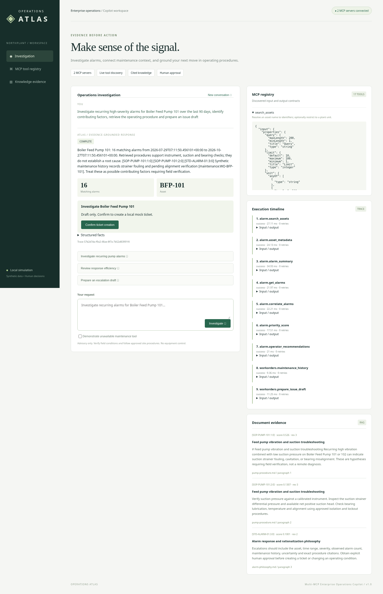

# Operations Atlas

**Multi-MCP Enterprise Operations Copilot** — investigate synthetic alarms, connect maintenance history, retrieve operating procedures, and prepare an evidence-backed escalation.



[Watch the working demo video](docs/evidence/demo.mp4) · [Architecture](docs/architecture.md) · [Tool catalog](docs/mcp-tool-catalog.md) · [Requirement checklist](docs/requirements.md)

## What works

- Two real, independently runnable MCP servers: **Alarm Management** (14 tools) and **Work Orders** (3 tools), using the official Python MCP SDK and stdio JSON-RPC.
- Schema-aware discovery and invocation, chained IDs, paginated source reads, bounded retries, safe errors, shared traces and visible partial results.
- All 15 Alarm Management simulator endpoints from the supplied Postman collections, including advanced analytics and safe allowlisted KPI execution.
- Local document ingestion and hybrid sparse vector retrieval, metadata and asset filters, citations, low-confidence handling and document trust boundaries.
- Responsive chat GUI with tool schemas, execution input/output timeline, evidence passages, loading/error/empty states and explicit ticket confirmation.
- Multiple intent paths and assets, explicit date ranges, relative-day windows, and conversation asset retention.

The application uses an explicit intent planner and extractive grounded generation; no paid LLM, external vector database, or enterprise credentials are required. Maintenance records, alarms, documents and tickets are synthetic. The second MCP server creates **local mock tickets**, not GitHub issues.

## Quick start

Requirements: Docker with Compose, or Python 3.12+.

```sh
git clone https://github.com/Sumanthh381/Multi-MCP-Enterprise-Operations.git
cd Multi-MCP-Enterprise-Operations
docker compose up --build
```

After both services become healthy, open the GUI at port **8080** on your machine. The alarm simulator runs on port **8000**, with interactive OpenAPI at `/docs`. Both published ports bind only to loopback. Compose starts the API first; the backend starts its own two MCP subprocesses and builds the retrieval index. The named `operations-data` volume retains mock tickets, drafts and the index. Stop with `docker compose down`; add `--volumes` only to intentionally erase local demo data.

Python alternative:

```sh
make install
make ingest
make run
```

Run commands from the repository root. `scripts/dev.py` starts the same application topology and shuts down its children on termination. Do not run local and Compose startup simultaneously on the same ports.

## Configuration

See [.env.example](.env.example). Compose reads an optional root `.env`; local Python processes read exported variables (they do not automatically load `.env`). Defaults work for the synthetic demo. `ALARM_API_TOKEN=demo-token` is the public fixture value from the supplied Postman collection. Replace it for any non-demo use, and never commit real credentials.

| Variable | Default / role |
|---|---|
| `ALARM_API_BASE_URL` | Local source at port 8000; Compose uses `http://alarm-api:8000` |
| `ALARM_API_TOKEN` | Public simulator fixture; must match in source and MCP client |
| `API_TIMEOUT_SECONDS` | 5-second source timeout, up to two retries |
| `DOCUMENT_PATH` | `rag/documents` |
| `RAG_INDEX_PATH` | `.runtime/rag-index.json` |
| `DATA_PATH` | `.runtime/operations.sqlite3` |
| `COPILOT_HOST` / `COPILOT_PORT` | Local launcher binding, defaults to loopback / 8080 |
| `SIMULATOR_NOW` | Optional synthetic clock; defaults to current UTC |
| `ENTERPRISE_ROOT` | Resource root, set to `/app` in the container |

No LLM key is required. This is a local demonstration without multi-user authentication. Do not expose it publicly without the controls described in [security and limitations](docs/known-limitations.md).

## Independent MCP servers

Start the simulator, then connect an MCP stdio client to either command:

```sh
.venv/bin/uvicorn enterprise.simulator:app --port 8000
.venv/bin/python -m enterprise.alarm_mcp
.venv/bin/python -m enterprise.workorders_mcp
```

The latter two commands speak MCP over stdin/stdout, not HTTP. In normal app startup, the backend owns these processes automatically. The GUI and `/api/tools` expose tool discovery including input/output JSON schemas.

Alarm tools: `search_assets`, `asset_metadata`, `get_alarms`, `alarm_detail`, `alarm_summary`, `alarm_trends`, `correlate_alarms`, `flood_analysis`, `rationalization_candidates`, `priority_score`, `operator_recommendations`, `generate_calculation`, `execute_calculation`, `kpi_definitions`.

Work-order tools: `maintenance_history`, `prepare_issue_draft`, `create_ticket`. See the [catalog](docs/mcp-tool-catalog.md) for every schema, source mapping, authentication, timeout, error behavior and captured example.

## Document ingestion

```sh
make ingest
```

Three synthetic Markdown documents produce eight paragraph-aware chunks. TF-IDF unigram/bigram vectors plus lexical coverage provide local hybrid retrieval, with asset-type filtering and a minimum relevance threshold. The index rebuilds at startup. Passages include document ID, revision, paragraph and hash; the GUI shows exact evidence. See [RAG design](docs/rag-design.md) and [example retrieval](docs/evidence/retrieval-example.json).

## Try it

- “Investigate recurring high-severity alarms for Boiler Feed Pump 101 over the last 90 days, identify contributing factors, retrieve the procedure and prepare an issue draft.”
- “Calculate operator response efficiency for Compressor 201 over the last 90 days.”
- “Identify the highest-priority alarm for Motor 501 and prepare an escalation summary.”
- “Show its trends” follows the last resolved asset within that conversation.
- “Find flood alarms for Boiler Feed Pump 102 from 2026-05-01 to 2026-07-01.”

The investigation resolves an asset through MCP, queries alarm analytics, retrieves paginated events, evaluates priority, calls the second MCP server for maintenance, retrieves procedures, and returns observations and cited guidance. It labels possible causes as hypotheses. An issue request prepares only a draft; **Confirm ticket creation** is a separate human action. Toggle the unavailable-maintenance demonstration to see an explicit failed tool with retained alarm and document evidence.

## Tests and evidence

```sh
make check                 # formatting, lint, static analysis
make test                  # unit, real MCP, retrieval, integration, E2E
.venv/bin/python scripts/smoke.py   # running app / Compose functional request
.venv/bin/pip-audit --disable-pip --no-deps -r requirements.lock
```

Recorded validation: **51 pytest tests passed**, **98% line coverage**, **62 Postman requests passed** across three collections, and dependency audit reported no known vulnerabilities. Coverage includes real MCP subprocesses, not just in-process mocks. [Validation details](docs/evidence/validation.md), [coverage JSON](docs/evidence/coverage.json), [JUnit](docs/evidence/tests.xml), [audit](docs/evidence/dependency-audit.json). One upstream FastAPI test-client deprecation warning remains.

CI runs formatting, linting, mypy, all tests, dependency audit, Docker build and a combined MCP-plus-RAG functional request. GitHub Actions status depends on the remote run; local results do not establish CI success.

The supplied collections are preserved under `postman/`; see [API integration](docs/api-integration.md) for Newman commands. Browser evidence was captured with `scripts/demo.py`, including schemas, successful execution, citations, confirmed mock ticket and degraded operation. [Video](docs/evidence/demo.mp4) · [Discovery](docs/evidence/02-discovery-schemas.png) · [Trace](docs/evidence/04-execution-trace.png) · [Degraded](docs/evidence/05-degraded.png) · [Mobile](docs/evidence/06-mobile.png).

## Architecture and repository layout

```text
apps/frontend/             Responsive HTML/CSS/JS GUI
src/enterprise/backend.py  FastAPI UI/API host and lifecycle
src/enterprise/orchestrator.py  Intent planning and grounded composition
src/enterprise/registry.py Schema-aware official MCP client
src/enterprise/alarm_mcp.py     Alarm Management MCP server
src/enterprise/workorders_mcp.py Work-order MCP + SQLite source
src/enterprise/connector.py     Authenticated source HTTP connector
src/enterprise/simulator.py     Full reference Alarm API simulator
src/enterprise/rag.py      Extraction, ingestion, index and retrieval
rag/documents/             Synthetic document corpus
tests/{unit,integration,e2e}/   Automated validation
postman/                   Original assignment API collections
docs/                      Architecture, catalogs, evidence, requirement matrix
scripts/                   Startup, smoke, browser and documentation helpers
```

This is the equivalent of the suggested multi-folder layout, packaged as one Python distribution with separate domain processes. [Architecture diagram](docs/architecture-diagram.png) explicitly shows MCP, RAG, data sources, observability and trust boundaries.

## Assumptions and limitations

One complete self-contained enterprise-operations workflow is the priority. The planner supports the documented vocabulary rather than arbitrary language; no remote LLM provider is implemented. SQL persistence is local, session memory is process-local, and synthetic analytics are illustrative. See [design decisions](docs/design-decisions.md), [known limitations and future improvements](docs/known-limitations.md), and [submission notes](docs/submission.md). No strict red/green TDD history or industrial safety certification is claimed.

For sandboxed Docker builders without network access, a trusted local cache can be prepared with `.venv/bin/pip download -r requirements.lock -d .build-wheels`; the Dockerfile uses it when present, otherwise it installs from the normal verified package index. This cache is ignored by Git and not retained in the image.
