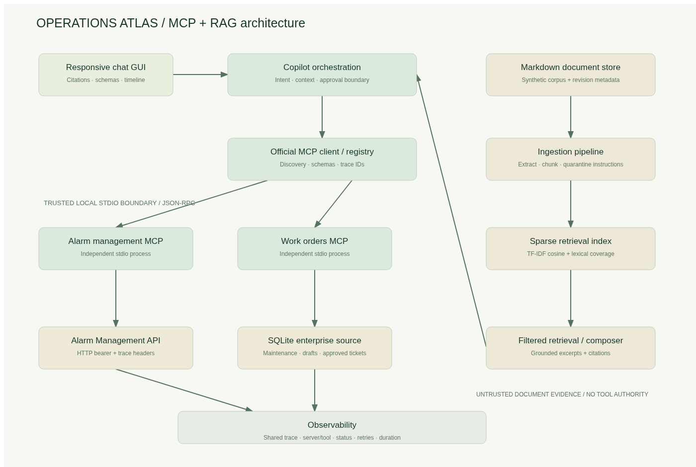
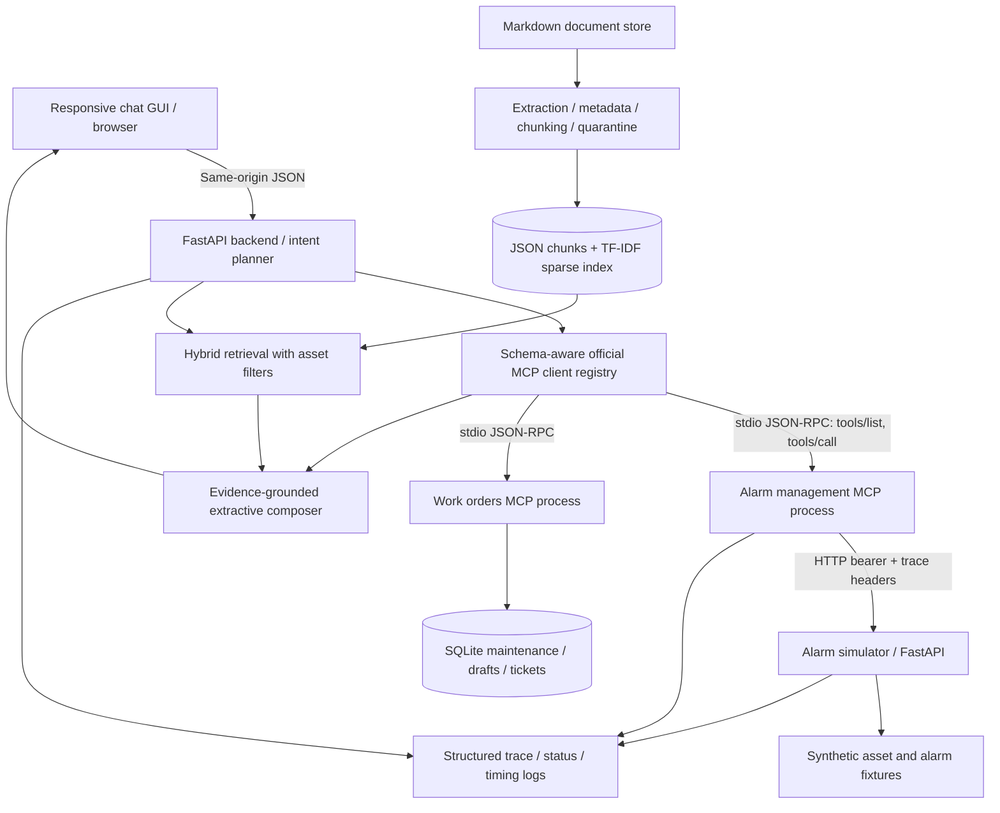

# Architecture and request flow

The browser sends a natural-language request to `/api/chat`. A bounded vocabulary planner chooses summary, correlation, trends, floods, rationalization, priority or efficiency. Asset names and IDs are resolved through the discovered `search_assets` MCP tool. Ambiguous names require clarification. A conversation retains the chosen asset for follow-up questions; generic requests naming another asset type do not inherit the previous type.

The registry initializes two independently runnable MCP subprocesses with the official SDK. It discovers tools and schemas, validates inputs before invocation and outputs after invocation, and records each step. Asset ID output drives metadata, paginated alarms and analytics; selected alarm IDs drive priority and recommendations. KPI requests generate a calculation ID and pass it into execution. A maintenance lookup on the other MCP server consumes the same resolved asset ID. The orchestration module never imports the source API connector.

In parallel conceptually (sequential in this implementation for readable traces), the retrieval boundary extracts a local Markdown corpus, rejects instruction-like paragraphs, makes overlapping chunks, and constructs a sparse TF-IDF index. Retrieval combines cosine relevance and lexical coverage with an asset-type filter. Selected passages are returned verbatim with document ID, revision, paragraph, chunk ID, content hash and score. An extractive composer combines computed observations with those passages, cites them, labels maintenance history as synthetic, and distinguishes correlation from causality. No arbitrary document instruction is executed; no document can authorize a tool call.

Optional-source failures preserve available alarm and RAG evidence and set `partial`. Required alarm-source failures stop the investigation and expose a safe error. No evidence means no generated recommended actions. Draft preparation is allowed without a write approval because it creates only a local proposed draft. A separate GUI confirmation invokes `create_ticket`; the backend verifies draft/conversation ownership. Writes are idempotent by draft ID. There is no equipment-control tool.

## Deployment and trust boundaries

Compose runs an alarm API container and a copilot container. The latter owns the two MCP stdio subprocesses, retrieval and GUI. No separately exposed MCP HTTP endpoint or vector database is needed. All images run as UID 10001; ports bind to loopback, root filesystems are read-only, and the SQLite/index volume is writable. Health checks enforce source-before-backend startup. The Python local launcher provides the equivalent workflow.

The UI is a local demonstration with no multi-user identity provider. Stdio ownership authorizes MCP access. The alarm API additionally authenticates bearer credentials. Before exposing beyond localhost, add user identity, role-based tool authorization, rate limits and a TLS reverse proxy. Conversation IDs are not authentication credentials. SQLite persists maintenance records, drafts and approved tickets; conversation state and KPI definitions reset on process restart. Retrieval rebuilds at startup.

The observability path carries a common trace ID through GUI results, MCP calls and API response headers. MCP events contain server, tool, duration, outcome, retry count, status and safe errors. API logs include path, trace and status. Retrieved document IDs and scores are present in the response. There is no LLM latency because this implementation uses an explicit planner and extractive generation. Full document content and bearer headers are excluded from logs.
