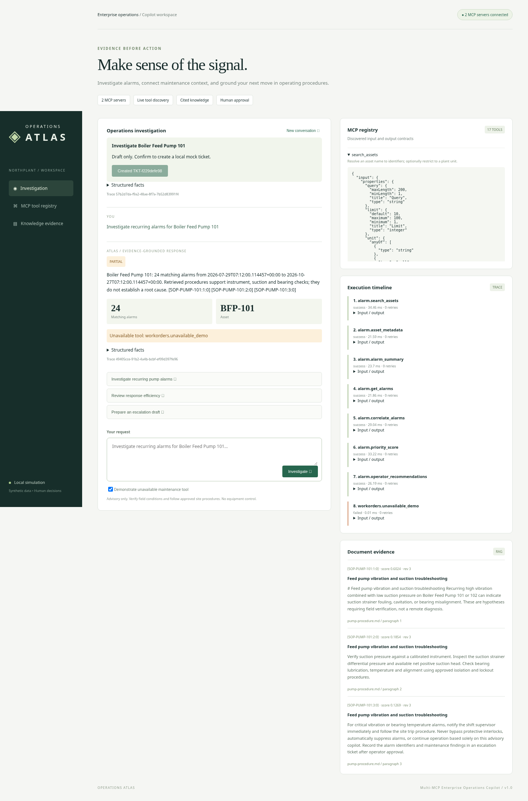

## Summary

Implement Operations Atlas, a self-contained Multi-MCP Enterprise Operations Copilot. An alarm investigation now resolves an asset through MCP, analyzes source API alarms, retrieves maintenance from a second MCP server, and returns operating-procedure evidence with citations in a responsive GUI.

## Scope and architecture

- Complete 15-endpoint authenticated simulator matching the supplied Postman URL/body/chaining contracts.
- Official SDK Alarm Management and Work Orders MCP processes, schema-aware client, cross-server chaining, safe errors, bounded retries and shared trace metadata.
- Markdown ingestion, sparse hybrid retrieval, filters, citations and document trust isolation.
- Bounded intent planner, conversation context, partial results, draft-first escalation and explicit mock-ticket confirmation.
- Non-root Docker Compose packaging, health checks, CI and reusable local startup.

## MCP tools and RAG

14 alarm tools cover asset search, metadata, retrieval, analytics, recommendations and KPIs. Three work-order tools provide maintenance history, draft preparation and approved local ticket creation. Eight indexed chunks from three synthetic documents support the same investigation workflow. Full schemas and examples are in the tool catalog.

## Screenshots and demo

- 
- 
- [Demo video](evidence/demo.mp4)

Paths above refer to files under `docs/` on the feature branch.

## Validation

Full pytest suite, real MCP integration and combined backend E2E pass; see committed JUnit and coverage evidence for the final counts. All 62 requests across supplied Postman collections passed. Formatting, lint, mypy, dependency audit, browser automation and containerized smoke test passed. The sandbox builder used a trusted host-downloaded pinned wheel cache because container DNS is unavailable. Remote CI has not been claimed as passed.

## Design decisions and limitations

An explicit planner and extractive composer avoid paid credentials and unpredictable tool selection. This is a bounded-language local demonstration. Source data, procedures, work orders and tickets are synthetic; there is no GitHub issue-writing integration or production identity provider. See the architecture, design decisions, requirements matrix and limitations documents.

## Review checklist

- [x] Alarm source integration uses MCP
- [x] Two MCP servers participate in one request
- [x] Document evidence and citations participate in the same workflow
- [x] Tool trace and schemas are visible
- [x] Write confirmation and idempotency are tested
- [x] No real credentials committed
- [x] Tests, static checks, browser and container validation completed
- [x] Architecture, video and test evidence included
